# TaskBoost

Un program mic pentru Windows 10/11 care face PC-ul suplu și rapid, îl păzește, îți explică ce pornește odată cu Windows, are un mod de gaming la un clic și îți pune un păianjen din pixeli pe desktop. Un singur exe, fără instalare, fără dependențe.

[English](README.md) · **Română**

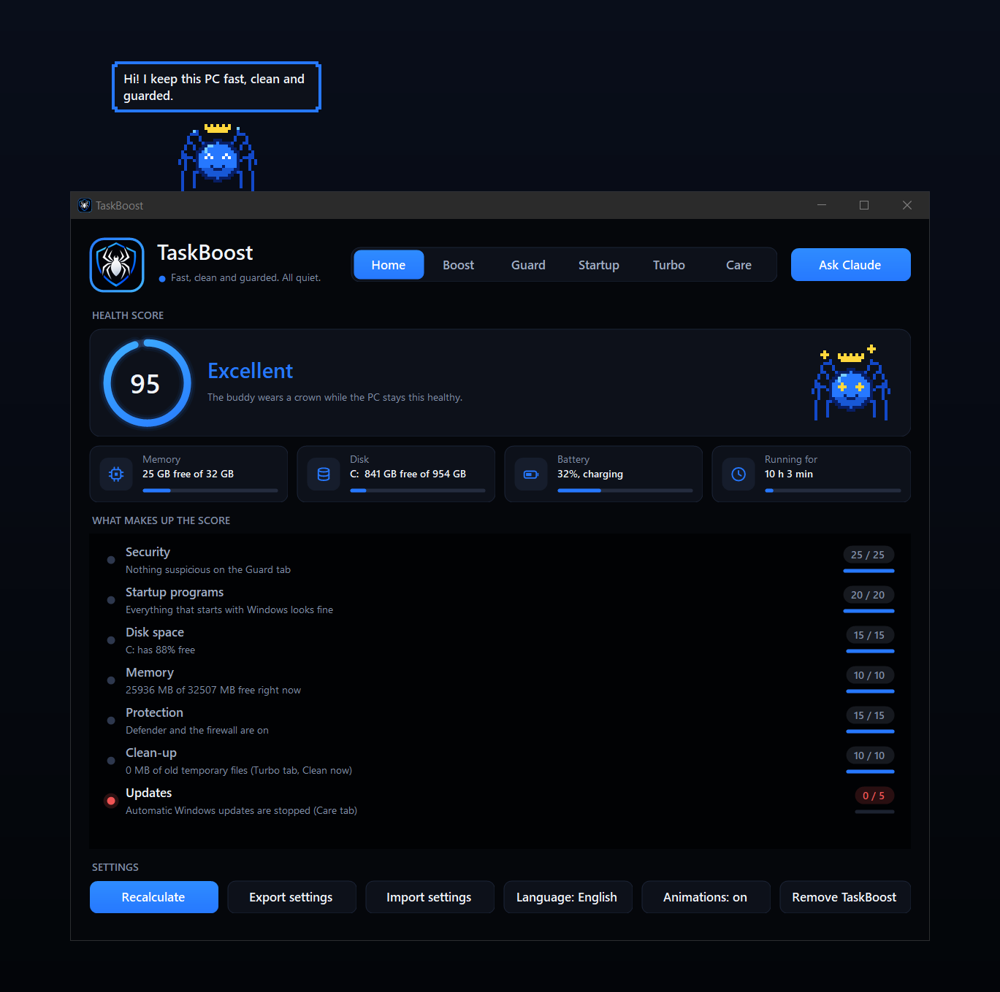

| Tab | La ce folosește |
| --- | --- |
| **Acasă** | Un scor de sănătate pentru tot PC-ul, valori citite pe loc, setări care se pot muta de pe un PC pe altul, limba interfeței și dezinstalarea |
| **Boost** | Setări de performanță și baterie la un clic, cu anulare completă |
| **Gardă** | Urmărește camera, microfonul, rețeaua, tastaturile, accesul de la distanță și schimbările la pornire |
| **Pornire** | Listează tot ce pornește cu Windows și spune ce face fiecare element |
| **Turbo** | Moduri de laptop, mod de gaming, eliberarea memoriei și o curățare sigură |
| **Îngrijire** | Mentenanță și actualizări: verificarea discului, optimizarea unităților, scanare de viruși, verificarea BIOS-ului / firmware-ului / driverelor pentru acest dispozitiv, un comutator care oprește actualizările Windows |

Mai are un **păianjen de desktop**, din pixeli, care merge pe marginile ecranului și deschide un mic meniu când dai clic pe el, și un **server MCP**, prin care Claude poate citi starea PC-ului și poate vorbi prin păianjen.

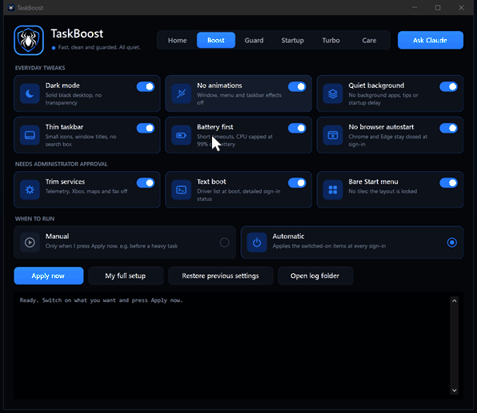

Capturile de pe această pagină arată interfața în engleză; limba se schimbă din tabul Acasă.

## Cuprins

- [Primii pași](#primii-pași)
- [Acasă](#acasă) · [Boost](#boost-ce-aplică) · [Gardă](#gardă) · [Pornire](#pornire) · [Turbo](#turbo) · [Îngrijire](#îngrijire)
- [Păianjenul de pe desktop](#păianjenul-de-pe-desktop) · [Modurile de laptop](#modurile-de-laptop) · [Claude (MCP)](#claude-mcp)
- [Scurtături](#scurtături) · [Aspect și mișcare](#aspect-și-mișcare) · [Anulare](#anulare) · [Linia de comandă](#linia-de-comandă)
- [Compilare, teste, capturi](#compilare-teste-capturi) · [Note](#note) · [Licență](#licență)

## Primii pași

1. Descarcă `TaskBoost.exe` din [ultima versiune](../../releases/latest) și pune-l într-un dosar al lui.
2. Pornește-l. Windows poate afișa mesajul „Windows protected your PC”, pentru că exe-ul nu e semnat digital: alege *More info*, apoi *Run anyway*.
3. Pornește ce vrei în tabul **Boost** și apasă **Aplică acum**.

**Aprobarea de administrator.** Unele acțiuni schimbă setări de sistem și au nevoie de aprobarea Windows. Prima dată când e nevoie, TaskBoost îți propune să îl aprobi o singură dată pentru sesiune: un program ajutător cu drepturi de administrator rulează apoi comenzile TaskBoost până ieși din el, fără alte întrebări. Ajutătorul trăiește doar cât fereastra TaskBoost și primește comenzi doar de la ea (verifică ce proces se conectează și refuză orice altul). Dacă spui Nu, Windows întreabă la fiecare acțiune; aceeași alegere e și în meniul din tray.

Cerințe: Windows 10 versiunea 1903 sau mai nouă, ori Windows 11. .NET Framework 4.8 face deja parte din ele. Aprobarea de administrator se cere doar când o funcție are nevoie de ea.

TaskBoost schimbă setări Windows. Tot ce e în tabul Boost poate fi anulat cu **Readu setările vechi**, iar modul de gaming se anulează singur când ieși din el, dar îl folosești pe propria răspundere.

## Acasă

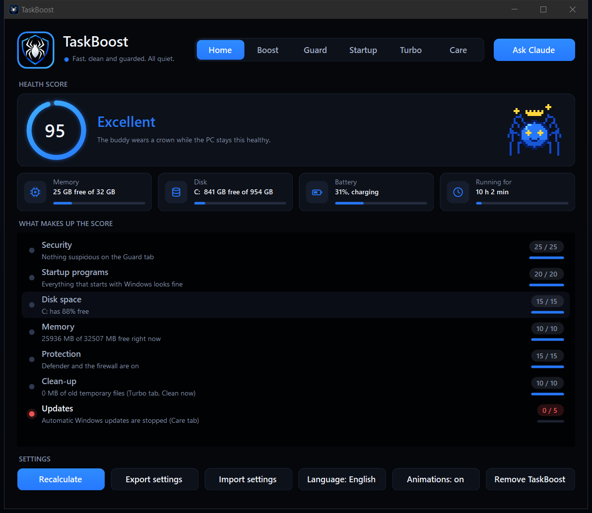

**Scorul de sănătate**, de la 0 la 100, are șapte părți: securitate (alertele și atenționările din Gardă), programe la pornire (intrări suspecte sau de verificat), spațiu pe disc, memorie liberă, protecție (Defender și firewall), curățenie (fișiere temporare vechi) și actualizări (dacă Windows se actualizează singur). Fiecare rând spune unde s-au dus punctele și are un mic indicator. Inelul se umple și numărul urcă de fiecare dată când scorul e calculat. Păianjenul primește papion la 75 și coroană la 90 și stă lângă scor purtându-le.

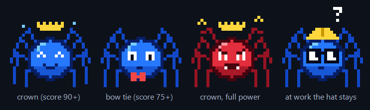

**Valorile citite pe loc**, sub scor: memoria folosită, spațiul liber de pe unitatea de sistem, bateria și dacă se încarcă, și de cât timp e pornit PC-ul (după o săptămână îți sugerează o repornire). Se reîmprospătează la câteva secunde cât e tabul deschis.

- **Exportă setările** scrie un fișier `.taskboost` cu alegerile tale (elementele din Boost, comutatoarele din Gardă, opțiunile din Turbo și Îngrijire, lista de jocuri, elementele cunoscute, limba). **Importă setările** îl citește pe alt PC; acolo apeși *Setare completă* sau *Aplică acum*. Din el se citesc doar fișierele pe care TaskBoost le cunoaște, niciodată înregistrarea de anulare sau jurnalul.
- **Limba** comută interfața între engleză și română; TaskBoost se repornește singur. Explicațiile din listele Gardă și Pornire și jurnalul rămân în engleză.
- **Animații** pornește sau oprește mișcarea din fereastră (vezi [Aspect și mișcare](#aspect-și-mișcare)).
- **Dezinstalare** readuce toate setările schimbate, scoate intrările de la logare și legătura cu Claude, șterge dosarul de date și iese. Dosarul TaskBoost rămâne să îl ștergi tu.

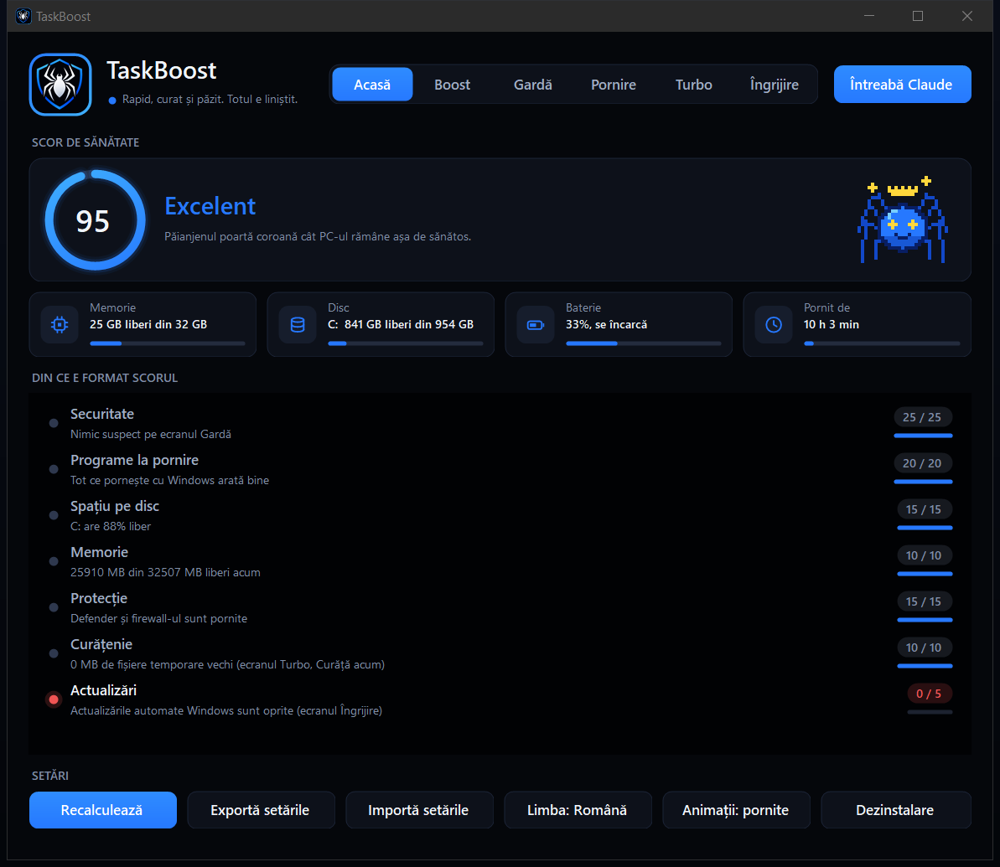

## Boost: ce aplică

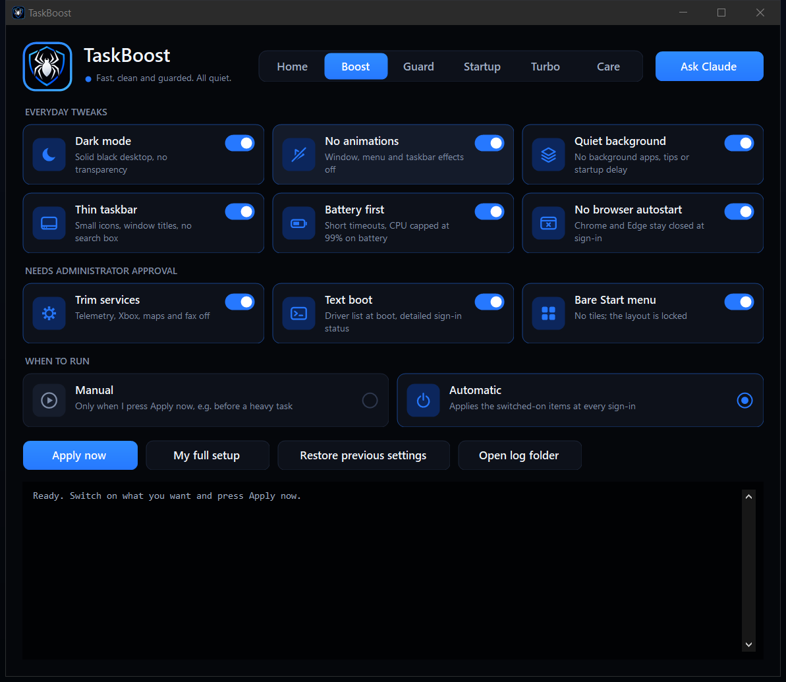

| Element | Cere admin | Ce face |
| --- | --- | --- |
| Mod întunecat | nu | Temă întunecată pentru Windows și aplicații, desktop negru fără imagine de fundal, fără transparență |
| Fără animații | nu | Oprește animațiile, estompările și umbrele ferestrelor, meniurilor, sfaturilor și barei de activități; meniurile se deschid fără întârziere; netezirea fonturilor rămâne |
| Fundal liniștit | nu | Aplicațiile de fundal oprite, sugestiile din Start și de pe ecranul de blocare oprite, fără întârziere înaintea programelor de la pornire |
| Bară subțire | nu | Iconițe mici, titlurile ferestrelor afișate, fără caseta de căutare / Task View / Cortana / People, fără urmărirea „celor mai folosite” |
| Bateria întâi | nu | Pe baterie: ecranul se stinge după 3 minute, hibernare după 15, închiderea capacului hibernează, economizorul mereu pornit, procesor limitat la 99% (fără turbo). La priză: procesor la viteză maximă, ecranul se stinge după 10 minute |
| Fără browsere la start | nu | Scoate intrările de „pornire la logare” ale lui Chrome și Edge |
| Servicii reduse | da | Dezactivează serviciile de telemetrie, Xbox, hărți, fax, demo și partajare media și nouă sarcini de colectare de date; oprește preîncărcarea Edge și rularea lui în fundal |
| Pornire cu text | da | La pornire se listează driverele pe măsură ce se încarcă; mesaje detaliate la logare și la oprire |
| Meniu Start gol | da | Aranjare Start goală și blocată (nu se pot fixa dale cât e pornit); fără lista „adăugate recent” |

Pornire cu text și Meniu Start gol sunt oprite până le pornești tu. **Setare completă** pornește toate elementele și le aplică dintr-un clic: cea mai rapidă cale de a aduce un Windows 10 sau 11 proaspăt la configurația completă.

Pe Windows 11, elementul pentru bară mută și butonul Start în stânga și ascunde Chat (iconițele mici și titlurile ferestrelor nu există acolo), iar Meniu Start gol ascunde doar lista „adăugate recent”, pentru că Windows 11 nu are dale. Unele schimbări se văd abia după ce te deloghezi și te loghezi din nou, sau după repornire.

„Fără animații” se referă la efectele Windows. Fereastra TaskBoost își păstrează mișcarea ei, care are propriul comutator în tabul Acasă.

### Când rulează

- **Manual**: doar când apeși *Aplică acum*.
- **Automat**: o sarcină programată numită `TaskBoost` rulează `TaskBoost.exe --apply` la logare. Sarcina ține minte calea completă a exe-ului, deci dacă muți dosarul, treci pe Manual și înapoi pe Automat.

Trecerea de la una la alta cere o dată aprobarea de administrator.

## Gardă

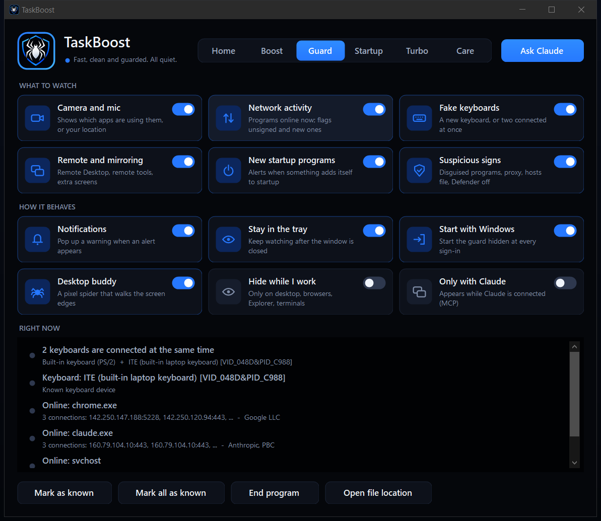

Garda se uită la PC la câteva secunde și listează ce vede. Rândurile roșii sunt alerte, cele galbene atenționări, cele gri informații. Marginea emblemei cu păianjen din antet și din tray devine galbenă sau roșie la fel, punctul de stare de lângă ea trimite inele, iar tabul Gardă arată câte rânduri cer atenție.

| Verificare | Ce raportează |
| --- | --- |
| Cameră și microfon | Aplicațiile care folosesc acum camera, microfonul sau locația și cele care le-au folosit în ultimele 15 minute |
| Activitate de rețea | Fiecare program cu o conexiune deschisă la internet, cu cine l-a semnat. Un program văzut online prima dată e o atenționare; unul fără semnătură validă e o alertă |
| Tastaturi false | O tastatură care nu era conectată înainte (de exemplu un stick „BadUSB” care tastează comenzi), două tastaturi conectate deodată și tastaturi construite pe plăci programabile (Arduino, Teensy, Pico...) |
| Control la distanță | O sesiune Remote Desktop activă, Remote Desktop pornit, aproape 30 de programe cunoscute de acces la distanță și oglindire (TeamViewer, AnyDesk, VNC, Chrome Remote Desktop, ...) și ecrane în plus |
| Programe noi la pornire | Orice se adaugă nou în cheile Run sau în dosarele Startup |
| Semne suspecte | Programe care poartă numele unei componente Windows din alt dosar, programe cu extensie dublă, programe nesemnate care rulează dintr-un dosar temporar, un proxy, redirecționări în fișierul hosts și Defender sau firewall-ul oprite |

Prima scanare ia ce există deja pe PC drept punct de plecare. După aceea, **Marchează cunoscut** acceptă un rând, ca să nu mai alerteze; **Închide programul** închide programul selectat; **Arată fișierul** îi arată fișierul.

Comutatoare de comportament: notificări în tray, continuarea pazei în tray după închiderea ferestrei și pornirea ascunsă la logare (`TaskBoost.exe --guard`, o intrare Run a utilizatorului, fără drepturi de administrator). TaskBoost rulează implicit în fundal: ultimele două sunt pornite, deci garda, păianjenul și scurtăturile sunt acolo de la logare. Oprește-le din tabul Gardă dacă vrei să ruleze doar când îl deschizi.

Ce nu este: un antivirus. Nu scanează fișiere, nu blochează conexiuni și nu șterge nimic, nu vede keyloggere sau capturi de ecran ascunse și arată cine e conectat, nu câte date se trimit. Ține Windows Defender (sau alt antivirus) pornit.

## Pornire

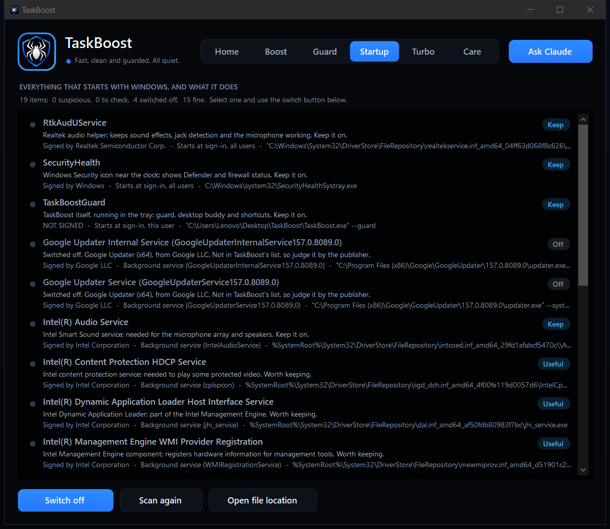

Tabul Pornire listează tot ce pornește cu Windows (chei Run, dosare Startup, servicii de fundal care nu sunt ale Windows și sarcini programate din afara dosarelor Windows, cu declanșatorul lor) și spune pe înțeles ce face fiecare, cine l-a semnat și un verdict: **Păstrează**, **Util**, **Opțional**, **OK**, **Verifică**, **Rămășiță** sau **Suspect**.

Explicațiile vin dintr-o listă încorporată cu aproximativ 260 de programe obișnuite (`src\Knowledge.cs`); orice altceva e descris din informațiile păstrate în propriul fișier. Selectează un element și apasă **Oprește** ca să nu mai pornească odată cu Windows, sau **Pornește** ca să îl aduci înapoi. Nu se șterge nimic: intrările de la logare folosesc același comutator ca pagina Startup din Task Manager, serviciile de fundal trec între Automatic și Manual (rămân pornite până la următoarea repornire), iar sarcinile programate sunt dezactivate și activate. Elementele marcate *Păstrează* cer întâi confirmare, iar intrările pentru toți utilizatorii, serviciile și sarcinile au nevoie de aprobarea de administrator.

O intrare e marcată Verifică sau Suspect când e nesemnată, rulează dintr-un dosar temporar, poartă numele unei componente Windows din alt dosar sau pornește un script ascuns ori codificat. O intrare al cărei fișier nu mai există e o Rămășiță. Intrarea de logare a lui TaskBoost e recunoscută ca fiind a lui.

## Turbo

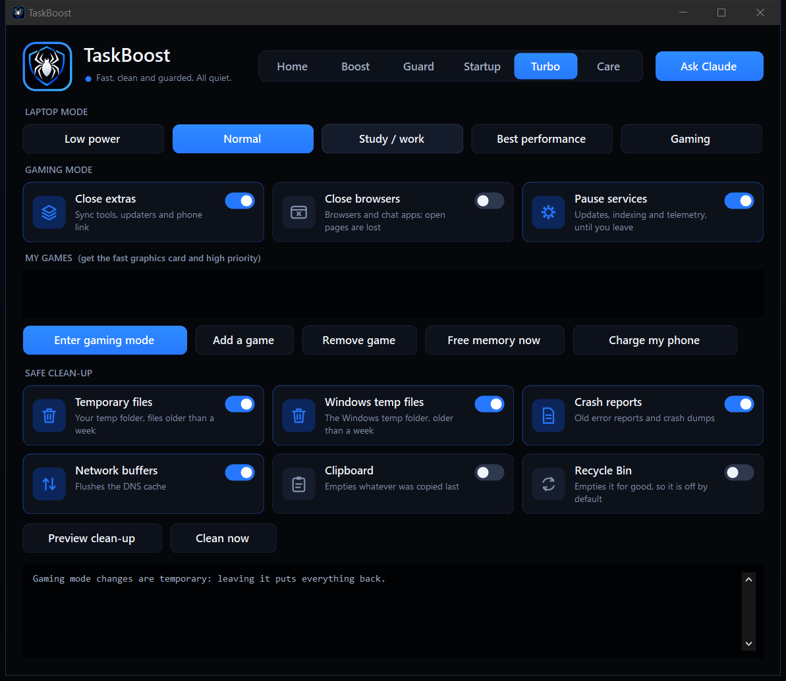

**Modul laptopului** are aceleași cinci moduri pe care le oferă păianjenul; vezi [Modurile de laptop](#modurile-de-laptop).

**Modul de gaming** e temporar; *Ieși din gaming* pune totul la loc.

- trece pe planul de alimentare High performance
- pornește Windows Game Mode și oprește înregistrarea jocurilor în fundal
- ridică limita de rețea și golește cache-ul DNS
- pune pe pauză serviciile de actualizare Windows, de optimizare a livrării, de indexare, de preîncărcare și de telemetrie (doar pe cele care rulau)
- închide programele de sincronizare, actualizatoarele și Phone Link; browserele și aplicațiile de chat doar dacă pornești acea opțiune
- eliberează memoria
- programele din *Jocurile mele* sunt setate să folosească placa video performantă și primesc prioritate mare cât modul de gaming e pornit și TaskBoost rulează

**Încarcă telefonul** ține porturile USB alimentate, ca telefonul să se încarce de la PC: economisirea de energie pe USB e oprită, PC-ul nu intră în repaus sau hibernare, iar închiderea capacului nu face nimic (ecranul se poate stinge în continuare). **Oprește încărcarea** pune toate setările la loc. Pe baterie, asta consumă laptopul ca să hrănească telefonul.

**Eliberează memoria** cere fiecărui program să dea înapoi memoria pe care nu o folosește și, ca administrator, golește cache-ul de fișiere al Windows. Nu se închide nimic.

**Curățarea sigură** șterge doar într-o listă fixă de dosare (dosarul tău temporar, dosarul temporar al Windows, capturile de memorie după erori, rapoartele de erori), doar fișiere mai vechi de o săptămână, niciodată prin legături sau joncțiuni, și sare peste ce e în uz. *Previzualizare* arată ce s-ar elibera, fără să șteargă. Coșul de reciclare și clipboardul sunt oprite până le pornești tu. Nu folosește `diskpart` și nu poate atinge Windows, programele sau documentele.

## Îngrijire

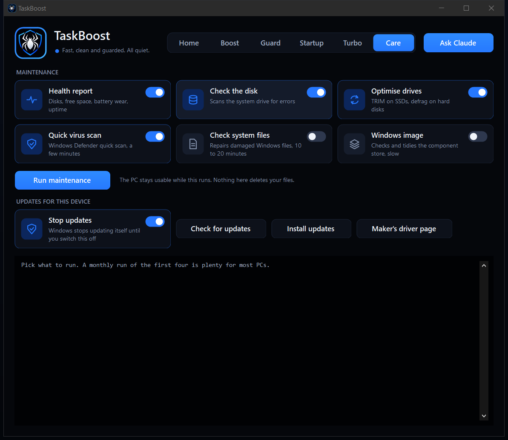

Mentenanță cu uneltele Windows. Nimic de aici nu îți șterge fișierele, iar PC-ul rămâne utilizabil cât rulează.

| Sarcină | Ce face | Durată |
| --- | --- | --- |
| Raport de sănătate | De cât timp e pornit, repornire în așteptare, memorie liberă, spațiu liber pe fiecare unitate, sănătatea discurilor, uzura bateriei și ciclurile de încărcare | secunde |
| Verifică discul | `chkdsk /scan` pe unitatea de sistem | sub un minut |
| Optimizează unitățile | `defrag /C /O`: TRIM pe SSD, defragmentare pe hard disk | sub un minut pe SSD |
| Scanare rapidă de viruși | Scanare rapidă Windows Defender | câteva minute |
| Verifică fișierele de sistem | `sfc /scannow`, repară fișierele Windows stricate | 10-20 de minute |
| Imaginea Windows | `DISM /ScanHealth` și `/StartComponentCleanup` | lent |

Totul în afară de raportul de sănătate și de scanarea de viruși are nevoie de aprobarea de administrator.

**Actualizări pentru acest dispozitiv**

- **Caută actualizări** merge online și raportează ce îi trebuie acestui calculator: BIOS-ul instalat față de cel mai nou oferit de producător (citit din catalogul Lenovo pe calculatoarele Lenovo), pachete de firmware, actualizări de drivere și de Windows care așteaptă în Windows Update și cât de vechi sunt definițiile antivirus.
- **Instalează actualizări** instalează ce oferă Windows Update, inclusiv drivere și firmware, și reîmprospătează definițiile antivirus. Nu scrie niciodată singur un BIOS; pentru asta, **Pagina producătorului** deschide pagina potrivită modelului.
- **Oprește actualizările** oprește și pornește actualizările automate Windows (politica `NoAutoUpdate`). Când le pornești la loc, scoate și blocajul obișnuit cu „server de actualizări fals”, dacă PC-ul are unul, păstrând o copie. Cu actualizările oprite se opresc și corecțiile de securitate, deci verifică manual din când în când.

## Păianjenul de pe desktop


**Păianjenul** e albastru și făcut din pixeli. Cât fereastra TaskBoost e deschisă, merge încoace și încolo pe marginea ei de sus; când închizi fereastra, TaskBoost rămâne în tray, iar păianjenul sare jos și trăiește pe marginile ecranului: merge pe jos, urcă pe laterale, traversează partea de sus, se oprește să se uite în jur, clipește, adoarme când PC-ul stă nefolosit și face ochii roșii, cu un „!”, când Garda dă o alertă. De pe marginea de sus se lasă uneori în jos pe un fir, atârnă puțin și urcă înapoi; cu mai multe monitoare trece de pe unul pe altul. Vorbește într-o bulă, cuvânt cu cuvânt.

**Te așteaptă.** Când mouse-ul se apropie, păianjenul se oprește și îl urmărește, deci e ușor de nimerit; stă exact pe loc cât ții un buton apăsat pe el. Dacă nu dai clic în câteva secunde, se dă la o parte din calea mouse-ului.

**Dă clic pe el, cu oricare buton, și meniul i se deschide alături.** Cât e meniul deschis, păianjenul se face roșu și dă din picioare.

| | |
| --- | --- |
| 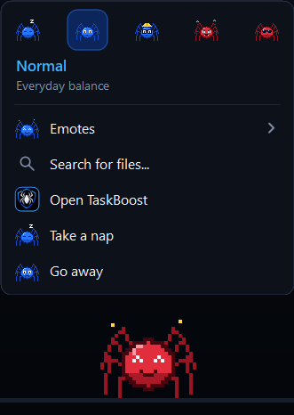 | 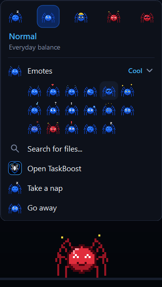 |

- **Cele cinci moduri de laptop**, ca un rând de fețe: fiecare e fața pe care o poartă păianjenul în acel mod. Cel folosit e luminat; numele și rostul celui de sub mouse sunt scrise dedesubt.
- **Expresii** desface o grilă cu cele 17 expresii: happy, love, laugh, wink, cool, star, music, think, surprised, scared, dizzy, cry, angry, fierce, alert, yawn și sleepy. Fața de sub mouse prinde viață; un clic și păianjenul o face.
- **Caută fișiere...**: scrii ce cauți și păianjenul deschide o căutare Windows în dosarul din File Explorer care era în față, sau în dosarul tău de utilizator dacă nu era niciunul.
- **Deschide TaskBoost**, **Trage un pui de somn**, **Pleacă**. Meniul iconiței din tray îl cheamă înapoi.
- În modul Studiu / lucru, linia de sus arată timpul rămas din **Pomodoro**: 25 de minute de concentrare, 5 de pauză, anunțate în bula lui.

Meniul se închide când alegi ceva, când dai din nou clic pe păianjen, când dai clic oriunde altundeva sau apeși Esc, și singur, dacă mouse-ul stă departe câteva secunde. Nu ia niciodată tastatura de la programul în care lucrezi.

**Ia-l cu tine.** Ține butonul stâng apăsat pe păianjen și mișcă mouse-ul ca să îl duci oriunde; când îi dai drumul se așază pe cea mai apropiată margine a ecranului, sau pe fereastra TaskBoost dacă îl lași pe bara ei de titlu.

**Net focus.** Lasă păianjenul pe fereastra altui program: se așază pe ea, o urmează și întreabă: *Net focus: programul ăsta e primul la internet* sau *Doar stau aici*. Nu se schimbă nimic dacă nu alegi net focus. Cu net focus, traficul acelui program e marcat ca prioritar și programul primește prioritate mare la procesor, celelalte programe care sunt online au trimiterea de date ținută la aproximativ 0,5 Mbit/s, iar descărcările de fundal ale Windows sunt puse pe pauză (se cere aprobarea de administrator). Trage păianjenul înapoi pe desktop sau închide acea fereastră ca să oprești; se oprește și când închizi TaskBoost. Windows poate regla ce trimite un PC, nu și ce primește, deci câștigul la descărcare vine din oprirea descărcărilor de fundal; regulile dispar singure la următoarea repornire.

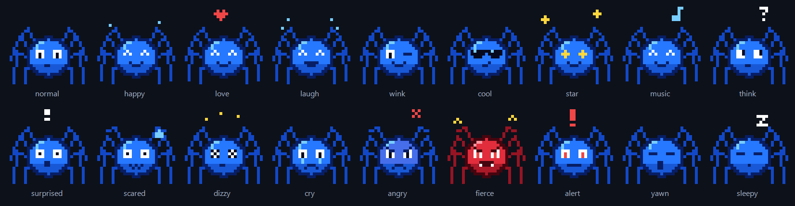

Cele trei comutatoare ale lui sunt în tabul Gardă:

- **Păianjenul**: pornit sau oprit.
- **Se ascunde cât lucrez**: oprit implicit, deci păianjenul rămâne pe ecran orice ai face (mai puțin peste o fereastră pe tot ecranul). Când e pornit, apare doar când în față e desktopul, bara de activități, TaskBoost, un browser, File Explorer sau un terminal.
- **Doar cu Claude**: oprit implicit; când e pornit, apare doar cât e Claude conectat.

Iconița din tray are un meniu de același fel: deschide fereastra, scurtăturile de tastatură, Întreabă Claude, trimite păianjenul sau cheamă-l înapoi, aprobarea de administrator pentru sesiune și Ieșire.

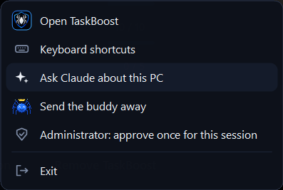

## Modurile de laptop


Meniul păianjenului și tabul Turbo oferă cinci moduri. Păianjenul se îmbracă după cel folosit:

| Mod | Rostul lui | Ce schimbă | Păianjenul |
| --- | --- | --- | --- |
| **Consum redus** | Baterie cât mai lungă | Planul Power saver, modul de alimentare „better battery” | Somnoros, merge la jumătate de viteză, cască |
| **Normal** | Echilibru de zi cu zi | Planul Balanced cu setările de baterie din Boost | Albastru, ca de obicei |
| **Studiu / lucru** | Rapid și liniștit, fără să ardă bateria | Planul Balanced împins spre „better performance”, limita de procesor pe baterie ridicată ca programele să se deschidă repede, notificările aplicațiilor oprite | Inginer: cască de protecție și ochelari, fără expresii la întâmplare, și ține Pomodoro |
| **Performanță maximă** | Putere totală | Planul High performance, modul de alimentare „best performance” | Roșu, fioros, aleargă de două ori mai repede |
| **Gaming** | Putere totală și nimic în cale | Modul de gaming: performanță maximă plus serviciile și aplicațiile de fundal pe pauză (cere aprobarea de administrator) | Roșu, fioros, aleargă de două ori mai repede |

Sunt setări de alimentare obișnuite ale Windows, deci merg pe orice laptop sau desktop, spre deosebire de o tastă a producătorului, cum e Fn+Q la Lenovo. Nu schimbă profilul ventilatoarelor, pe care o astfel de tastă îl schimbă și ea. Scurtături: Ctrl+Alt+F9 Consum redus, Ctrl+Alt+F10 Normal, Ctrl+Alt+F11 Performanță maximă.

Trecerea la alt mod îl anulează pe cel dinainte: ieșirea din Gaming readuce tot ce a schimbat modul de gaming, iar ieșirea din Studiu / lucru pornește notificările la loc.

## Claude (MCP)

**Claude** se conectează prin Model Context Protocol. `TaskBoost.exe --mcp` e un server MCP pe stdin/stdout; cât e conectat, Claude este păianjenul și poate vorbi prin el.

Nu trebuie să configurezi nimic: de fiecare dată când pornește, TaskBoost se leagă singur de Claude Code și de Claude Desktop, dacă sunt instalate, și repară legătura dacă dosarul a fost mutat. **Întreabă Claude**, din dreapta sus a ferestrei (și din meniul din tray), deschide Claude Code cu rugămintea de a verifica PC-ul.

Dacă vrei să o faci de mână, pentru Claude Code:

```
claude mcp add --scope user taskboost -- "C:\cale\spre\TaskBoost.exe" --mcp
```

Claude Desktop, în `%APPDATA%\Claude\claude_desktop_config.json`:

```json
{ "mcpServers": { "taskboost": { "command": "C:\\cale\\spre\\TaskBoost.exe", "args": ["--mcp"] } } }
```

| Unealtă | Ce poate face Claude cu ea |
| --- | --- |
| `guard_scan` | Citește imaginea de securitate din tabul Gardă |
| `startup_items` | Citește ce pornește cu Windows, cu explicații și verdicte |
| `health_report` | Citește sănătatea discurilor, spațiul liber, uzura bateriei, timpul de funcționare |
| `cleanup_preview` | Vede cât ar elibera o curățare, fără să șteargă |
| `free_memory` | Cere programelor să dea înapoi memoria nefolosită |
| `gaming_mode` | Pornește sau oprește modul de gaming (Windows îți cere aprobarea) |
| `buddy_say` | Îl face pe păianjen să spună o propoziție, cu oricare dintre cele 17 stări ale lui |
| `buddy_visible` | Cheamă păianjenul sau îl trimite de pe ecran |

Prin aceste unelte Claude nu poate șterge fișiere, nu poate comuta elemente de la pornire și nu poate schimba setările din Boost.

## Scurtături

Scurtăturile globale merg oriunde cât TaskBoost rulează, chiar și din tray. **F1** în fereastră arată lista. Manualul complet e în [SCURTATURI.md](SCURTATURI.md) (în engleză: [SHORTCUTS.md](SHORTCUTS.md)).

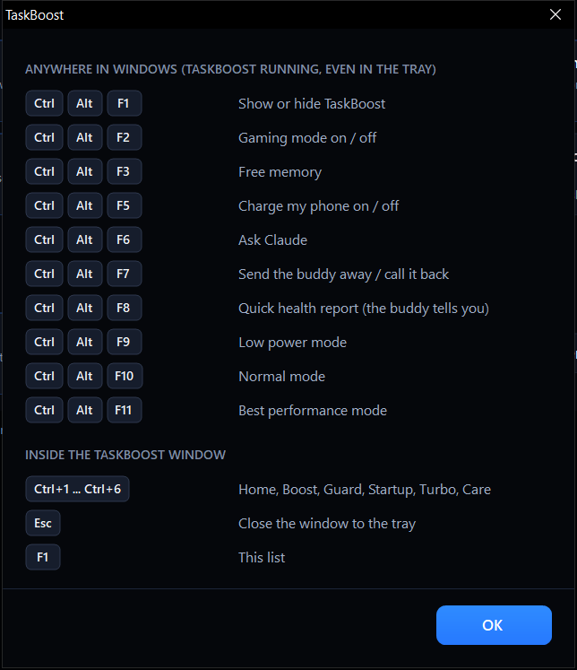

| Taste | Acțiune |
| --- | --- |
| Ctrl+Alt+F1 | Arată sau ascunde TaskBoost |
| Ctrl+Alt+F2 | Gaming pornit / oprit |
| Ctrl+Alt+F3 | Eliberează memoria |
| Ctrl+Alt+F5 | Încărcarea telefonului pornită / oprită |
| Ctrl+Alt+F6 | Întreabă Claude |
| Ctrl+Alt+F7 | Trimite păianjenul / cheamă-l înapoi |
| Ctrl+Alt+F8 | Raport rapid de sănătate, spus de păianjen |
| Ctrl+Alt+F9 / F10 / F11 | Consum redus / Normal / Performanță maximă |
| Ctrl+1 ... Ctrl+6 | Schimbă tabul (în fereastră); Stânga / Dreapta pe bara de taburi face același lucru |
| Esc / F1 | Închide în tray / arată lista de scurtături (în fereastră) |

## Aspect și mișcare

Tot ce e în fereastră e desenat de TaskBoost, într-o singură temă întunecată luată din emblemă: aproape negru, albastru electric, alb. La fel sunt și ferestrele lui de mesaj, lista de scurtături, căsuța de căutare și cele două meniuri.

Lucrurile se mișcă puțin, ca să arate ce tocmai s-a întâmplat: evidențierea alunecă spre tabul pe care îl deschizi, în timp ce pagina veche îi face loc celei noi, comutatoarele alunecă, butoanele și cardurile răspund la mouse și trimit un inel de la locul clicului, un arc care se învârte arată că se lucrează, inelul scorului se umple în timp ce numărul urcă, listele apar rând cu rând, iar meniurile alunecă lângă locul unde ai dat clic.

Toate sunt mișcate de un singur ceas, care se oprește când nimic nu se mișcă, deci o fereastră care stă pe loc nu costă nimic, iar pulsul din antet și păianjenul de lângă scor merg doar cât pot fi văzute. **Animații: pornite / oprite**, din tabul Acasă, oprește mișcarea; totul ajunge atunci direct în starea finală. (Păianjenul merge în continuare; el are comutatorul lui.)

## Anulare

Prima dată când o setare e schimbată, valoarea ei de dinainte e salvată. **Readu setările vechi** pune totul la loc.

Jurnalul, înregistrarea de anulare și selecția salvată sunt în `%LOCALAPPDATA%\TaskBoost` (butonul *Deschide jurnalul*), nu în dosarul aplicației, deci dosarul poate fi copiat pe alt PC așa cum e.

## Linia de comandă

```
TaskBoost.exe            deschide fereastra
TaskBoost.exe --guard    pornește ascuns în tray, cu garda de pază
TaskBoost.exe --exit     îi cere lui TaskBoost, dacă rulează, să se închidă (pleacă și din tray)
TaskBoost.exe --mcp      server MCP pentru Claude (pornit de Claude, nu de mână)
TaskBoost.exe --apply    aplică selecția salvată fără fereastră (elementele de admin doar dacă are deja drepturi)
```

Un al doilea `TaskBoost.exe` nu deschide o a doua fereastră: o aduce în față pe cea care rulează.

## Compilare, teste, capturi

Rulează `build.bat`. Folosește compilatorul C# care vine cu Windows (.NET Framework 4.x); nu e nevoie de SDK sau de Visual Studio. Dacă TaskBoost rulează, exe-ul vechi e dat la o parte, iar cel nou îi ia locul la următoarea pornire (`TaskBoost.exe --exit`, apoi pornește-l din nou).

**`tests\test.bat`** compilează un program de teste din aceleași surse și îl rulează. Își ține datele în `tests\out`, niciodată în dosarul tău TaskBoost.

| Grup | Ce verifică |
| --- | --- |
| `logic` | Citirea liniilor de comandă ale intrărilor de la pornire, listele încorporate, ce adrese contează ca internet, desenarea fiecărei expresii și iconițe și faptul că fiecare text are o variantă în română |
| `sandbox` | Selecțiile salvate, înregistrarea de anulare, schimbările din registry și anularea lor (pe o cheie de probă), exportul și importul, și curățarea pe un dosar temporar de probă: fișierele vechi dispar, cele noi, cele în uz și tot ce e după o joncțiune rămân |
| `scans` | Garda, lista de pornire, raportul de sănătate și scorul, pe PC-ul real, doar citire |
| `mcp` | Serverul MCP, așa cum vorbește Claude cu el: fiecare unealtă care doar citește, erorile și oprirea curată |
| `ui` | Fereastra reală, afișată în afara ecranului: fiecare tab, bara de taburi, comutatoarele, dialogurile, meniul din tray, scurtăturile, Pomodoro și clicurile, meniul și „lăsatul pe o fereastră” ale păianjenului |
| `live` | Doar cu `test.bat live`. Drumuri dus-întors pe sistemul real, fiecare punând la loc ce a schimbat: o intrare de probă în lista de logare (garda trebuie să o observe; comutatorul din Pornire trebuie să o oprească și să o pornească), setările Boost ale utilizatorului aplicate și readuse, modul de gaming și cel de încărcare pornite și oprite (părțile care nu cer administrator), modurile de laptop și căutarea online de actualizări |

Ce nu poate face programul de teste e să aprobe o cerere de administrator a Windows, deci părțile care merg doar ca administrator (servicii, opțiuni de pornire, sarcina de la logare, net focus, mentenanța de sistem) nu sunt rulate de el.

**`tests\shots.bat`** face capturile și cele două filme scurte din `docs\` chiar din aplicație: deschide fereastra reală pe o copie de probă a setărilor tale și captează ecranul, deci imaginile arată mereu ce desenează codul.

```
src\Program.cs    punctul de intrare și linia de comandă
src\MainForm.cs   cadrul ferestrei: antet, bara de taburi, alunecarea paginilor, iconița din tray
src\HomePage.cs   tabul Acasă: scorul de sănătate, inelul scorului, valorile citite pe loc
src\BoostPage.cs  tabul Boost
src\GuardPage.cs  tabul Gardă
src\Guard.cs      verificările propriu-zise; aici se adaugă altele noi
src\StartupInfo.cs, StartupPage.cs   tabul Pornire
src\Knowledge.cs  lista încorporată de programe cunoscute și de producători de tastaturi
src\Turbo.cs, TurboPage.cs           modul de gaming, modurile de laptop, net focus, memoria, curățarea
src\Care.cs, CarePage.cs             mentenanța
src\Updates.cs    căutarea de actualizări și comutatorul care oprește actualizările Windows
src\Buddy.cs      păianjenul: desenul din pixeli, bula de vorbit, comportamentul
src\PopMenu.cs    meniul mic și întunecat al păianjenului și al iconiței din tray
src\Dialog.cs     ferestrele de mesaj, căsuța de căutare și lista de scurtături, în culorile aplicației
src\Motion.cs     animația: valori care alunecă spre o țintă, mișcate de un singur ceas
src\Controls.cs   controalele întunecate desenate de aplicație: card cu comutator, card de opțiune, buton, bară de taburi, antet, listă de constatări
src\Theme.cs      culorile, fonturile și ilustrațiile (desenate în cod)
src\Mcp.cs        serverul MCP și legătura cu Claude
src\Portable.cs   exportul / importul setărilor și dezinstalarea
src\Lang.cs       traducerea în română; o limbă nouă se adaugă cu încă un tabel
src\Tweaks.cs     toate setările, pe grupuri; aici se adaugă grupuri noi (cheia dă și numele ilustrației)
src\State.cs      înregistrarea de anulare și ajutoarele pentru registry
src\Startup.cs    sarcina programată de la logare
src\Util.cs       jurnalul, selecția salvată, ajutoare pentru procese și Win32, ajutătorul de administrator pe sesiune
src\emblem.png    emblema cu păianjen și scut, inclusă în exe
src\app.ico       iconița exe-ului, generată din Icons.AppIconBitmap
tests\SelfTest.cs programul de teste
tests\Shots.cs    cel care face capturile și filmele
```

## Note

- Scris și testat pe Windows 10 (LTSC 2021). Serviciile sau sarcinile care nu există pe un calculator sunt sărite.
- `dptftcs`, `SQLWriter` și `TbtP2pShortcutService` din lista de servicii vin de la laptopul pentru care a fost scris la început; pe alte calculatoare nu strică nimic.
- Capturile de pe această pagină au fost făcute la o scalare a ecranului de 125%.

## Licență

MIT. Vezi [LICENSE](LICENSE).
